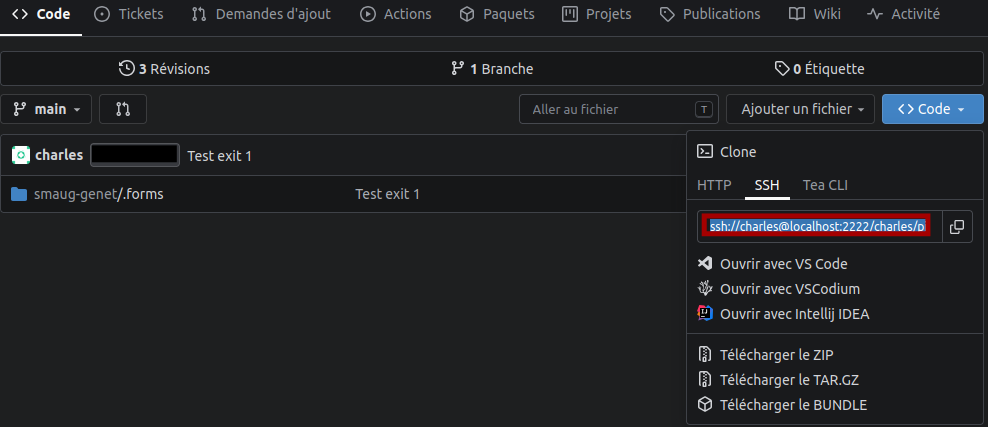

# A l'attention des bioinformaticiens

Ce guide est un tutoriel à destination des bioinformaticiens pour les aider à intégrer leurs pipelines bio-informatiques.

## Développement d'un pipeline

1. Première étape: cloner le dépôt git dans votre home

Pour cela suivez les instructions sur gitea (seule plateforme supportée actuellement par SMAUG).



Choisissez préférentiellement l'option avec ssh, qui est plus sécurisée.

```bash
# Adaptez selon les indications du dépôt gitea indiqué par votre sysadmin
git clone ssh://gitea@server:2222/owner/repo
```

2. Rédaction du code du pipeline avec snakemake

Bien que smaug ne restreigne pas le type de gestionnaire de pipelines, ce tutoriel utilise snakemake.

Dans le fonctionnement de smaug, à chaque fois que vous lancez l'analyse, smaug va créer un dossier dédié dans `{dossier d'analyse}/run-{run_id}` (où `run_id` est simplement un nombre entier qui s'incrémente à chaque nouvelle déclaration, et `dossier d'analyse` étant un dossier commun sur le cluster, déterminé par l'administrateur système).

Dans ce dossier dédié, l'application va:
- exécuter un `git clone` du dépôt configuré par le sysadmin. Cette action est précédée, si nécessaire, de la suppression du dossier du même nom si celui-ci existe déjà.
- checkout, dans ce dossier tout juste cloné, la révision exacte qui a été enregistrée dans la base de données de smaug **au moment où l'utilisateur a cliqué** sur `valider`
- exécuter le script défini dans le formulaire (voir le paragraphe ...) avec pour dossier courant le dossier `{dossier d'analyse}/run-{run_id}`. Permet l'exécution de commandes avec des chemins relatifs: vous vous trouvez dans un dossier avec à la fois vos fichier à analyser, ainsi que tous les pipelines de l'équipe.


Astuce: utilisez les liens symboliques au maximum pour éviter les répétitions et les copies inutiles

Exemple, pour ré-utiliser des règles snakemake communes:
- `ln -s`